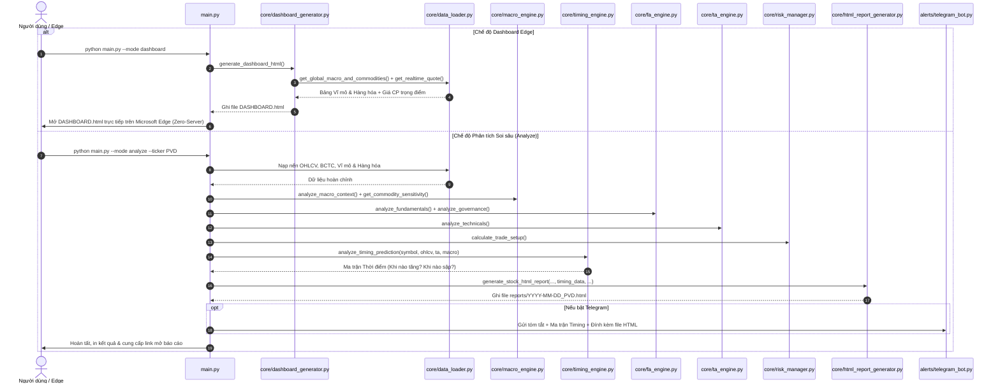

# 📐 TÀI LIỆU THIẾT KẾ KIẾN TRÚC & MÔ HÌNH ĐỊNH LƯỢNG (ARCHITECTURE & FORMULAS)

> Tài liệu kỹ thuật chuyên sâu dành cho các chuyên gia dữ liệu, lập trình viên và các mô hình AI tiếp quản dự án.

---

## 1. MÔ HÌNH TOÁN HỌC & ĐỊNH LƯỢNG (QUANTITATIVE MODELS)

### A. Chỉ số Sức khỏe Tài chính Piotroski F-Score (Thang điểm 0 - 9)
Chỉ số này do Giáo sư Joseph Piotroski phát triển nhằm chấm điểm sức khỏe tài chính doanh nghiệp:
* **Khả năng sinh lời (Profitability):**
  1. $ROA > 0$: +1 điểm (Lợi nhuận ròng trên tổng tài sản dương).
  2. $ROE > 10\%$: +1 điểm (Hiệu quả sử dụng vốn chủ sở hữu tốt).
  3. $\Delta ROA > 0$ hoặc Tăng trưởng LNST dương: +1 điểm.
  4. Tăng trưởng LNST $> 15\%$: +1 điểm.
* **Đòn bẩy tài chính & Thanh khoản (Leverage & Liquidity):**
  5. $Debt / Equity < 1.0$: +2 điểm (Nợ vay trong tầm kiểm soát an toàn).
  6. $Debt / Equity \in [1.0, 1.8]$: +1 điểm.
* **Hiệu quả hoạt động (Operating Efficiency):**
  7. Biên lợi nhuận gộp $Gross Margin > 15\%$: +1 điểm.
  8. Biên lợi nhuận ròng $Net Margin > 8\%$: +1 điểm.
  9. Tăng trưởng Doanh thu thuần $> 8\%$: +1 điểm.

### B. Định giá theo Phong cách Warren Buffett & Biên An Toàn (Margin of Safety)
* **Con hào kinh tế (Moat):** $ROE \ge 15\%$ và $ROIC \ge 12\%$ liên tục.
* **Giá trị hợp lý ước tính (Fair Value):**
  $$FairValue = CurrentPrice \times \left( \frac{TargetPE}{CurrentPE} \right)$$
  *(Với $TargetPE \approx 15.0$ cho các doanh nghiệp đầu ngành tại Việt Nam).*
* **Biên an toàn (Margin of Safety - MoS):**
  $$MoS = \frac{FairValue - CurrentPrice}{FairValue} \times 100\%$$
  Khuyến nghị mua khi $MoS \ge 20\%$.

### C. Định giá theo Phong cách Peter Lynch (GARP & PEG)
* **Hệ số PEG:**
  $$PEG = \frac{P/E}{EPS\ Growth\ Rate\ (\% Doanh\ thu\ hoặc\ Lợi\ nhuận)}$$
* **Quy chuẩn đánh giá:**
  * $PEG \le 0.7$: Cổ phiếu tăng trưởng siêu rẻ (Fast Grower Undervalued) $\rightarrow$ Khuyến nghị **MUA MẠNH**.
  * $0.7 < PEG \le 1.0$: Mức giá hợp lý (GARP) $\rightarrow$ Khuyến nghị **MUA**.
  * $PEG > 1.5$: Định giá đã chạy trước tốc độ tăng trưởng $\rightarrow$ Khuyến nghị **QUAN SÁT/THẬN TRỌNG**.

### D. Hệ thống Động lượng William O'Neil & Mark Minervini (CANSLIM)
* **Trend Template (Bộ lọc Xu hướng):**
  1. $Price > EMA20$
  2. $EMA20 > EMA50$
  3. Đường $EMA50$ dốc lên.
* **Bùng nổ Khối lượng (Volume Spike):**
  $$Volume_{today} \ge 1.3 \times MA20_{volume}$$
  Chứng minh có sự tham gia bảo trợ giá của các quỹ đầu tư tổ chức (Institutional Sponsorship).
* **Điểm Bứt Phá Nền Giá (Breakout Pivot):**
  $$Price \ge Resistance_{20\ phiên} \quad \text{và} \quad Volume \ge 1.3 \times MA20_{vol}$$

### E. Quản trị Rủi ro & Tỷ lệ Lợi nhuận / Rủi ro (Chief Risk Officer)
* **Điểm Cắt Lỗ Cứng (Stop Loss):**
  $$StopLoss = \max(Support_{20d},\ CurrentPrice - 1.5 \times ATR_{14})$$
  **Giới hạn trần:** Tuyệt đối không để mức cắt lỗ vượt quá **7%** từ giá mua ($StopLoss \ge CurrentPrice \times 0.93$).
* **Tỷ lệ Risk / Reward (R:R):**
  $$R:R = \frac{TakeProfit_1 - Entry}{Entry - StopLoss}$$
  Hệ thống **chỉ phê duyệt tín hiệu MUA** khi $R:R \ge 2.0:1$.

### F. Định giá theo Khối tài sản ròng & Radar Cảnh báo Thao túng giá ảo (Asset-Based Valuation & Manipulation Radar)
Mô hình này giải quyết bài toán: **Thị giá cổ phiếu có tương xứng với tài sản thực tế không, hay đang bị đội lái thổi phồng giá ảo?**

* **Giá trị Sổ sách mỗi cổ phiếu (Book Value Per Share - BVPS):**
  $$BVPS = \frac{\text{Vốn chủ sở hữu}}{\text{Số lượng CP lưu hành}}$$
* **Hệ số Định giá Tài sản ($P/B$):**
  $$P/B = \frac{CurrentPrice}{BVPS}$$
* **Mức Chiết khấu / Thặng dư Tài sản ròng:**
  $$\Delta_{Asset}\% = \frac{BVPS - CurrentPrice}{BVPS} \times 100\%$$
* **Thang đo 5 Cấp độ Rủi ro Thao túng & Thổi giá ảo (Manipulation Risk Levels):**
  1. **Cấp 1 - Món hời tài sản (Asset Bargain):** $P/B < 1.0x$. Thị giá thấp hơn cả vốn chủ sở hữu ròng. Rủi ro thổi giá: **RẤT THẤP**.
  2. **Cấp 2 - Định giá hợp lý (Fair Value):** $P/B \in [1.0x, 2.2x]$ đi kèm $ROE \ge 10\%$.
  3. **Cấp 3 - Định giá cao (Valuation Premium):** $P/B \in [2.2x, 3.8x]$. Đòi hỏi tăng trưởng EPS cao và Moat bền vững.
  4. **Cấp 4 - Cảnh báo Bong bóng đầu cơ (Speculative Bubble):** $P/B > 3.8x$ nhưng $ROE < 10\%$ hoặc lợi nhuận lẹt đẹt.
  5. **Cấp 5 - BÁO ĐỘNG ĐỎ: Thao túng / Bơm thổi giá ảo (High Manipulation):** $P/B > 5.0x - 10.0x$ trong khi ROE $< 5\%$ hoặc lỗ triền miên.

### G. Bóc tách Mô hình Kinh doanh Cốt lõi & Phân khúc (Core Business Segment Breakdown)
* **Tỷ trọng Doanh thu (% Revenue Share):** Mảng tạo quy mô dòng tiền (Scale Base).
* **Tỷ trọng Lợi nhuận gộp (% Gross Profit Share):** Mảng sinh lợi nhuận ròng thực tế.
* **Phân loại đặc thù:**
  * **Con bò sữa tạo tiền (Cash Cow):** Biên lãi gộp vượt trội ($>50\%$), tài trợ chi phí vốn.
  * **Trụ cột quy mô (Scale Base):** Doanh số lớn, bảo đảm công ăn việc làm.
  * **Ngòi nổ bùng nổ (Catalyst):** Bàn giao dự án hoặc chu kỳ hàng hóa tăng vọt.

### H. Quản trị Doanh nghiệp, Cơ cấu Cổ đông & Radar Phát hiện Tăng vốn ảo (Corporate Governance & Circular Capital)
* **Điều kiện kích hoạt Báo động đỏ Cấp 5/5 (Circular Capital Fraud Risk):**
  $$\text{Số cty con} \ge 6 \quad \text{và} \quad \frac{\text{Phải thu}}{\text{Tổng tài sản}} > 30\% \quad \text{và} \quad \frac{\text{Tổng nợ vay}}{\text{Tiền mặt}} > 4.5x$$
* **Định vị Bẫy Giá trị (Value Trap):**
  Khi $P/B < 1.0x$ nhưng tài sản đọng vốn $(\text{Phải thu} + \text{Tồn kho}) / \text{Tổng tài sản} > 38\%$ hoặc Nợ vay / Tiền mặt $> 4.5x$: **Hạ điểm an toàn vốn từ 90 xuống 20, xếp vào BẪY GIÁ TRỊ, không khuyến nghị mua.**

---

### I. ĐỘNG CƠ DỰ BÁO THỜI ĐIỂM (TIMING MATRIX ENGINE: KHI NÀO TĂNG? KHI NÀO SẬP?)

Động cơ định lượng trả lời hai câu hỏi quan trọng nhất của nhà đầu tư: **"Nếu mua thì khi nào sẽ tăng?"** và **"Dấu hiệu nào cảnh báo khi nào sẽ sập?"**.

```text
TIMING ENGINE ARCHITECTURE:
[Dòng tiền Wyckoff / VSA] ──┐
[Mô hình Kỹ thuật Pivot]  ──┼──> [Timing Engine Matrix] ──> { Kịch bản TĂNG: Trigger, T+, Xác suất }
[Độ trễ Vĩ mô / Hàng hóa] ──┘                               { Kịch bản SẬP: Cảnh báo, Failure Level }
```

#### 1. Định lượng Kịch bản Tăng ("Khi nào sẽ tăng?"):
* **Tín hiệu Kỹ thuật & Dòng tiền:**
  * Khối lượng cạn kiệt ở nền giá tích lũy (VSA No Supply / Spring gom hàng: $Vol < 0.75 \times MA20$).
  * Giá tiệm cận hoặc bứt phá đỉnh hộp 20 phiên: $Price \ge Pivot_{trigger}$.
  * RSI phân kỳ dương hoặc MACD cắt lên trên trục 0.
* **Thời gian thẩm thấu Vĩ mô & Hàng hóa (Macro Transmission Lag):**
  $$\Delta t_{macro} \in [1, 3]\ \text{phiên giao dịch}$$
  Khi giá hàng hóa thế giới (Dầu, Cao su, Thép...) tăng mạnh, dòng tiền trong nước thường có độ trễ 1-3 phiên để phản ánh trọn vẹn vào giá cổ phiếu.
* **Xác suất Tăng ($P_{pump}$):**
  $$P_{pump} = 50\% + 15\% \times \mathbb{I}_{vol\_dry} + 15\% \times \mathbb{I}_{macro\_tailwind} + 10\% \times \mathbb{I}_{trend\_up} \quad (\text{Tối đa } 88\%)$$
* **Khung thời gian dự kiến:** Bứt phá trong vòng **T+1 đến T+3** nếu dòng tiền xác nhận vượt $Pivot_{trigger}$ với khối lượng $> 1.3 \times MA20$.

#### 2. Định lượng Kịch bản Sập ("Khi nào sẽ sập?"):
* **Dấu hiệu Cảnh báo Sập:**
  * Bẫy phân phối ngầm Upthrust / Buying Climax: Nến râu trên dài, nổ khối lượng kỷ lục nhưng giá không tăng tương xứng.
  * Phân kỳ âm RSI/MACD tại vùng quá mua ($RSI > 70$).
  * Hiện tượng "Tin tốt ra là bán" (Sell the news): Khi tin tức vĩ mô/KQKD đạt đỉnh nhưng giá bị xả mạnh.
* **Mốc Kích hoạt Thất bại (Failure Trigger Level):**
  $$FailureLevel = \min(Support_{20d},\ EMA20)$$
  Nếu thủng mốc này kèm khối lượng bán lớn, kịch bản tăng chính thức bị hủy bỏ, rủi ro điều chỉnh sâu $7\% - 15\%$ được kích hoạt ngay lập tức.

---

### J. RADAR MA TRẬN VĨ MÔ & HÀNG HÓA THẾ GIỚI (GLOBAL MACRO & COMMODITIES)

Mô hình quét liên tục ma trận hàng hóa thế giới và dữ liệu liên thị trường:
1. **Biến số Vĩ mô Tiền tệ:** Lãi suất FED (Fed Funds Rate), Lạm phát Mỹ (US Core CPI), Chỉ số Sức mạnh Đồng USD (DXY), Tỷ giá USD/VND tại Ngân hàng Nhà nước.
2. **Hàng hóa Trọng yếu:** Dầu Brent & WTI, Vàng thế giới & SJC, Cao su TSR20 & TOCOM, Thép HRC, Phân bón Urea.
3. **Độ nhạy Ngành (Commodity Sector Sensitivity):**
   * **Dầu khí (PVD, PVS, BSR, GAS):** Độ nhạy Dầu Brent cao ($+10\%$ giá dầu $\rightarrow$ biên lãi gộp và giá dịch vụ khoan tăng mạnh).
   * **Cao su (GVR, PHR, DPR):** Độ nhạy Cao su TSR20 cao ($+5\%$ giá cao su $\rightarrow$ lợi nhuận mảng mủ cao su tăng đột biến).
   * **Thép (HPG, NKG, HSG):** Độ nhạy Thép HRC và Quặng sắt.
   * **Phân bón & Hóa chất (DPM, DCM):** Độ nhạy Giá Phân bón Urea thế giới.

---

## 2. QUY TRÌNH LUỒNG DỮ LIỆU THỰC TẾ (DATA PIPELINE)



---

## 3. KIẾN TRÚC ZERO-SERVER OFFLINE TRÊN MICROSOFT EDGE

1. **Giao diện Không Cần Server (Zero-Server UI):**
   - Không phụ thuộc vào web server địa phương (như Flask, FastAPI hay Node.js).
   - Tận dụng chuẩn giao thức `file:///d:/...` chạy trực tiếp trên Microsoft Edge.
   - Toàn bộ thư viện biểu đồ và font chữ được xử lý theo dạng Portable (CDN có fallback hoặc nhúng script nội tuyến nhẹ), bảo đảm tốc độ mở trang dưới 100ms.
2. **Bảo mật Cục bộ Tuyệt đối (Local Privacy):**
   - Toàn bộ cơ sở dữ liệu (`data/market.db`), hồ sơ phân khúc (`data/segments/`), và báo cáo phân tích (`reports/`) nằm trọn vẹn trên ổ cứng của người dùng.
   - Không truyền bất kỳ dữ liệu cá nhân hay lịch sử phân tích nào lên máy chủ bên ngoài.
