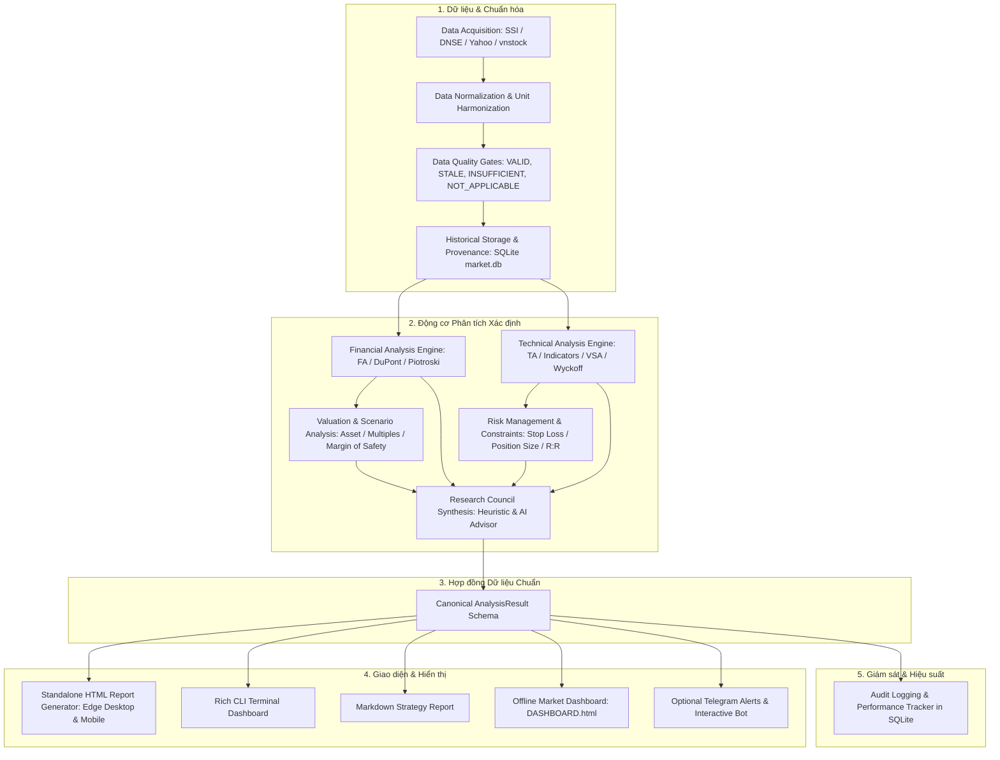

# ARCHITECTURE_TARGET.md — Kiến Trúc Hệ Thống Chuẩn Local-First Vietnam Stock Analyzer

## 1. Triết Lý Thiết Kế & Mục Tiêu Cốt Lõi
Hệ thống được thiết kế theo mô hình **Local-First, Deterministic-Engine & Pure-Presentation Separation**:
1. **Toàn vẹn số liệu (Data Correctness First):** Tính toán tài chính là xác định (deterministic), minh bạch, có thể kiểm chứng độc lập bằng unit tests.
2. **Một nguồn chân lý (Single Source of Truth):** Toàn bộ chỉ số tài chính, định giá, thiết lập kỹ thuật và khuyến nghị được đóng gói trong một schema duy nhất: `Canonical AnalysisResult`. Tầng hiển thị (HTML, CLI Terminal, Markdown, Telegram, Dashboard) chỉ hiển thị dữ liệu từ schema này, tuyệt đối không tự tính toán lại.
3. **Môi trường phát triển AI-Agnostic:** Sử dụng được cả trên Codex lẫn Google Antigravity mà không phụ thuộc vào API độc quyền của bất kỳ IDE nào. Các tích hợp LLM API (Gemini, OpenAI, Anthropic, Ollama) chỉ là tính năng tham mưu bổ trợ tùy chọn, không phải điều kiện bắt buộc để chạy hệ thống.
4. **Vận hành độc lập trên Windows:** Tối ưu hóa cho Windows PowerShell và Microsoft Edge (mở file `file:///...` trực tiếp không cần server chạy nền).
5. **Bảo tồn dữ liệu:** Bảo vệ toàn vẹn `data/market.db`, file segment người dùng và các báo cáo đã tạo.

---

## 2. Mô Hình Phân Lớp 12 Tầng (12-Tier Architecture)

---

## 3. Chi Tiết Các Tầng Chức Năng

### 3.1 Data Acquisition & Normalization (`core/data_loader.py`)
- **Nhiệm vụ:**
  - Thu thập giá khớp lệnh realtime (SSI iBoard / DNSE fallback).
  - Thu thập chuỗi nến lịch sử OHLCV điều chỉnh.
  - Thu thập Báo cáo tài chính (Cân đối kế toán, Kết quả kinh doanh, Lưu chuyển tiền tệ theo quý).
  - Thu thập Quản trị doanh nghiệp, Ban điều hành, Cổ đông lớn, Công ty con.
  - Thu thập chỉ số vĩ mô và hàng hóa thế giới.
- **Quy tắc chuẩn hóa:**
  - Đơn vị giá: Chuẩn hóa 100% sang VNĐ (ví dụ 25.4 nghìn đồng $\to$ 25,400 VNĐ).
  - Khối lượng: Cổ phiếu nguyên chiếc.
  - Kỳ báo cáo: Chuẩn hóa nhãn `YYYY-QX` (ví dụ: `2024-Q3`).
  - Ghi nhận nguồn gốc (`source_type`: `REALTIME_EXCHANGE`, `DAILY_CANDLE`, `LOCAL_CACHE`, `REFERENCE_BENCHMARK`) và thời điểm lấy dữ liệu (`as_of_date`).

### 3.2 Data Quality Gates (`core/data_quality.py`)
- Mỗi tập dữ liệu đầu vào phải đi qua cổng kiểm định chất lượng:
  - `VALID`: Đầy đủ, mới nhất, vượt qua kiểm tra logic kế toán.
  - `VALID_WITH_WARNINGS`: Có dữ liệu nhưng một số chỉ tiêu phụ bị thiếu.
  - `STALE`: Dữ liệu cũ quá thời gian quy định (ví dụ BCTC quá 2 quý chưa có số liệu mới).
  - `INSUFFICIENT`: Thiếu số liệu thiết yếu (ví dụ không có số lượng cổ phiếu lưu hành hoặc thiếu báo cáo lưu chuyển tiền tệ).
  - `NOT_APPLICABLE`: Tiêu chí không áp dụng cho mô hình kinh doanh này (ví dụ: chỉ số Vay nợ phi tài chính không áp dụng cho Ngân hàng).

### 3.3 Core Financial Engine (`core/fa_engine.py`)
- Tính toán các chỉ tiêu cơ bản theo đúng chuẩn mực tài chính:
  - Tăng trưởng Doanh thu & LNST TTM.
  - Biên lợi nhuận gộp, biên hoạt động, biên ròng.
  - ROE, ROA, ROIC.
  - Phân tích chất lượng lợi nhuận (Accrual Ratio, CFO/Net Profit).
  - Dòng tiền tự do FCF = CFO - CapEx.
  - Piotroski F-Score (chuẩn hóa 9 tín hiệu so sánh YoY khi có 2 kỳ).
  - Chỉ số kiệt quệ tài chính Altman Z''-Score (Emerging Market formula).
  - Xử lý ngành tài chính (Ngân hàng, Chứng khoán) với logic riêng biệt.

### 3.4 Technical Engine (`core/ta_engine.py`)
- Tính toán chỉ báo kỹ thuật trên chuỗi nến:
  - EMA20, EMA50, SMA200.
  - RSI 14, MACD (12, 26, 9), ATR 14.
  - Khối lượng bình quân 20 phiên và tỷ lệ nổ vol.
  - Nhận diện ngưỡng Hỗ trợ và Kháng cự 20 phiên gần nhất.
  - Nhận diện mẫu hình nền giá (VCP, Flat Base) và hành vi VSA (No Supply, Spring, SOS, Upthrust).

### 3.5 Valuation & Scenario Analysis (`core/fa_engine.py`)
- Định giá tài sản: BVPS, TBVPS, NCAVPS (Net-Net Graham), Net Cash Per Share.
- Định giá bội số: P/E, P/B, PEG (chỉ tính khi có đủ điều kiện toán học).
- So sánh thị giá với Giá trị hợp lý ước tính (Fair Value) và tính Biên an toàn (Margin of Safety).
- Đưa ra kịch bản Cơ sở (Base), Tích cực (Bull), và Tiêu cực (Bear) kèm điều kiện mất hiệu lực rõ ràng.

### 3.6 Risk Management Engine (`core/risk_manager.py`)
- Kiểm định tính hợp lệ của thiết lập giao dịch (`has_valid_setup`).
- Nếu vi phạm bộ lọc kỹ thuật hoặc sức khỏe tài chính yếu $\to$ xuất trạng thái `NO_VALID_SETUP`.
- Nếu có thiết lập hợp lệ:
  - Mức cắt lỗ (Stop Loss) đặt dưới hỗ trợ kỹ thuật hoặc theo ATR.
  - Mục tiêu chốt lời gắn liền với kháng cự kỹ thuật và biên định giá.
  - Quản trị tỷ trọng vốn danh mục (% NAV) dựa trên nguyên tắc giới hạn rủi ro 1.5% NAV cho mỗi vị thế.

### 3.7 Research Council Synthesis (`ai/council.py`)
- Hoạt động theo mô hình 5 góc nhìn độc lập kết hợp phản biện:
  1. Trường phái Giá trị (Buffett–Munger).
  2. Trường phái Tăng trưởng (Lynch–Fisher).
  3. Trường phái Kỹ thuật & Dòng tiền (Minervini–Wyckoff).
  4. Trường phái Vĩ mô & Chu kỳ (Dalio–Marks).
  5. Trường phái Quản trị rủi ro & Phản biện (CRO).
- Có chế độ hoạt động quy chuẩn xác định (Deterministic Rule-Based Deliberation) khi chạy offline hoặc không có API key.

### 3.8 Canonical AnalysisResult Model (`core/models.py`)
- Schema Pydantic/Dataclass trung tâm làm Hợp đồng Dữ liệu thống nhất cho toàn bộ hệ thống.

### 3.9 Standalone HTML Report Generator (`core/html_report_generator.py`)
- Nhận đầu vào là `AnalysisResult`.
- Render báo cáo HTML độc lập, mở mượt mà trên Edge.
- Thiết kế theo chuẩn Báo cáo Nghiên cứu Phân tích Chiến lược (Institutional Equity Research Report).
- Tích hợp biểu đồ tương tác kèm cơ chế Fallback SVG/Table nội tuyến khi không có internet.

---

## 4. Bảo Đảm Tương Thích & Tính Bền Vững
- **Không phá vỡ dữ liệu cũ:** Bảng `eod_quotes`, `recommendations`, `stock_master`, `performance_tracking` trong `data/market.db` tiếp tục được lưu trữ và cập nhật qua các adapter tương thích ngược.
- **CLI Modes giữ nguyên:** `python main.py HPG`, `python main.py --mode fa HPG`, `python main.py --mode ta HPG`, `python main.py --radar`, `python main.py --dashboard` đều hoạt động trơn tru.
- **Web App & Telegram:** Tương thích trực tiếp thông qua lớp `StockService`.
